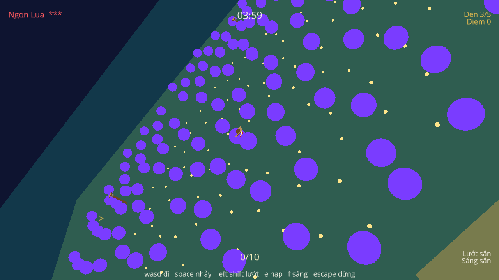

# Đảo Đèn Lồng

Ba đêm trên đảo. Mây nhặt đom đóm, giữ đèn còn dầu tới bình minh, và né Bóng Mực.



Video demo chưa có trong repo. Cách quay nằm trong [SUBMISSION.md](SUBMISSION.md). Khi có file, đặt ở `docs/demo/demo.mp4` hoặc đính vào Release `v1.0.0`.

## Yêu cầu

Python 3.12 trở lên. Windows 10/11, macOS hoặc Linux. Chơi và benchmark cần màn hình. Headless, soak và pytest không cần GPU hay cửa sổ.

## Cài và chơi

Trong thư mục repo, tối đa ba lệnh:

```bash
python3 -m venv .venv && source .venv/bin/activate
pip install -r requirements.txt
python3 -m lantern play
```

Trên Windows, dùng `python` và `.venv\Scripts\activate`.

## Điều khiển

Mặc định:

- W A S D hoặc phím mũi tên: đi. Hướng theo camera.
- Chuột: xoay camera.
- Space: nhảy khi đang chạm đất.
- Shift trái: lướt.
- E: nạp đom đóm vào đèn gần nhất còn nhận dầu.
- F: tỏa sáng, tốn 3 đom đóm.
- Esc hoặc P: tạm dừng.
- Enter: bắt đầu, vào đêm, hoặc sang đêm sau.
- Ở menu, L mở bảng xếp hạng.

Trong tạm dừng, phím 3 mở cài đặt. Ở đó đổi được âm lượng, độ nhạy chuột, bảng màu dễ phân biệt, giảm chuyển động, cỡ chữ, và từng phím. Phím trùng thì bị từ chối. Phím R khôi phục phím mặc định. Cài đặt được lưu trong `~/.dao-den-long/settings.json`.

Giảm chuyển động tắt rung camera và chớp màn hình. Chữ trên HUD không nhỏ hơn 18 px ở 1280×720. Chữ lớn nhân thêm 1.25.

Khi Bóng Mực mới xuất hiện, gió sắp thổi, còn 10 giây, hoặc đèn có dầu dưới 30, HUD hiện dòng chữ. Bóng Mực mới còn có mũi tên ở mép màn hình.

Sau khi thắng Đêm 3 hoặc thua một đêm, game hỏi tên (3–12 chữ, số, dấu gạch dưới, hoặc chữ có dấu) để lưu điểm. Esc bỏ qua. Bảng giữ 10 mục, điểm cao hơn đứng trên, hòa thì người đạt trước đứng trên.

```bash
python3 -m lantern play --export-leaderboard out.json
```

## Điểm và luật

Mỗi đom đóm nạp vào đèn được 5 điểm. Thắp lần đầu được 100, thắp lại được 40. Bóng Mực trúng Tỏa Sáng được 5, hoặc 15 nếu nó đang hút dầu. Thắng lúc bình minh thì mỗi đèn đang sáng được `50 + floor(dầu)` và mỗi Ngọn Lửa còn lại được 50.

Đêm 1, 2, 3 dài 240, 270, 300 giây. Hết Ngọn Lửa thì thua ngay. Hết giờ mà còn đủ đèn đang sáng thì thắng. Đêm 1 cần 3/5. Túi bắt đầu từ 10, tăng 2 sau mỗi lần thắp, tối đa 20.

Số liệu nằm trong [game.contract.json](game.contract.json). Quyết định dầu và bình minh: [docs/notes/adr-0001-lantern-fuel.md](docs/notes/adr-0001-lantern-fuel.md).

## Test, headless, bench, soak

```bash
python3 -m pytest
python3 -m lantern headless --seed 1 --night 1 --ticks 300 --out out.jsonl
python3 -m lantern bench --seed 42 --duration 30 --out bench.json
python3 -m lantern soak --seed 7 --nights 10 --out soak.json
```

Benchmark mở cửa sổ 1280×720, không toàn màn hình. Vsync được tắt bằng cấu hình Panda3D `sync-video false` trước khi tạo cửa sổ. Nếu driver vẫn ép vsync, trường `vsync_off` trong file kết quả ghi đúng giá trị đọc lại được. Ba giây đầu không tính. Đừng tắt cửa sổ đang đo.

Soak chạy headless 10 đêm trong một tiến trình. Đêm thứ i dùng seed `7 + i`, với i bắt đầu từ 1.

Bản Docker chạy test, headless và soak, không chạy cửa sổ:

```bash
docker build -t dao-den-long .
docker run --rm dao-den-long
docker run --rm dao-den-long python3 -m lantern soak --seed 7 --nights 10 --out soak.json
```

## Bằng chứng

[docs/proof/phase-4](docs/proof/phase-4) có `bench.json` và `soak.json` đo trên máy làm bài. Ngưỡng FPS là của máy chấm, không phải của file này. Các phase trước nằm ở `docs/proof/phase-1` đến `phase-3`.
